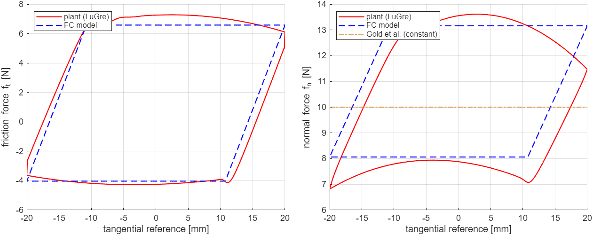
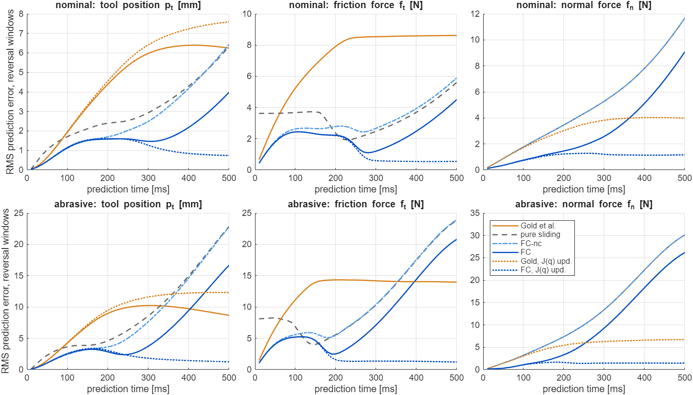
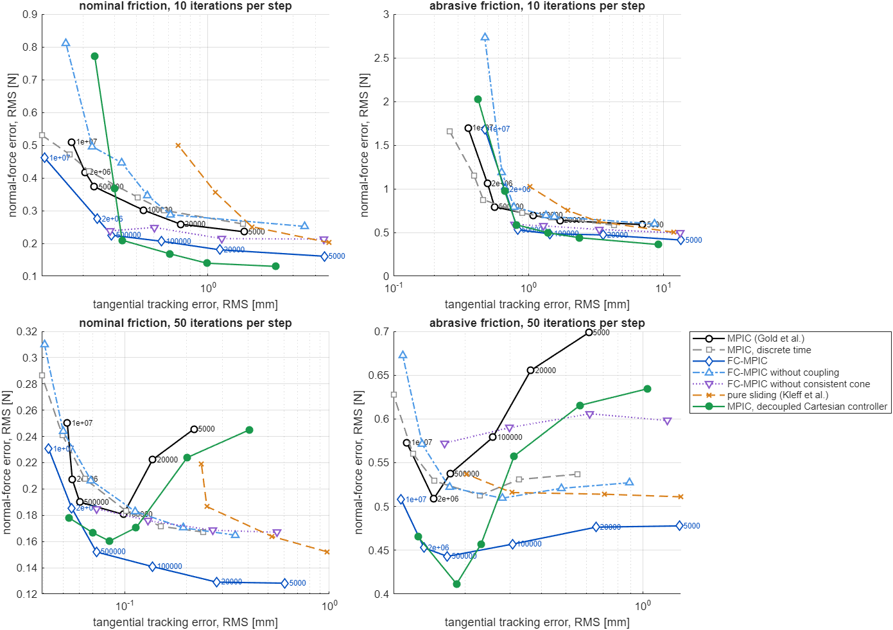
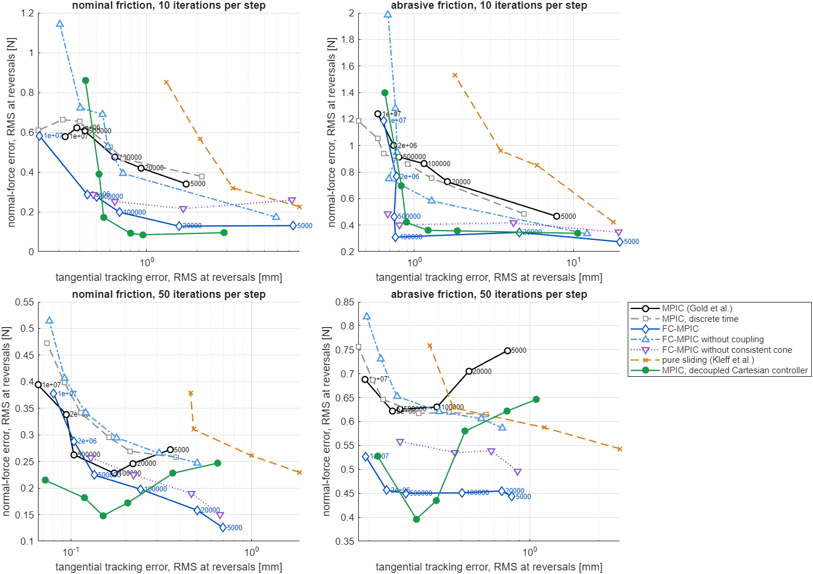
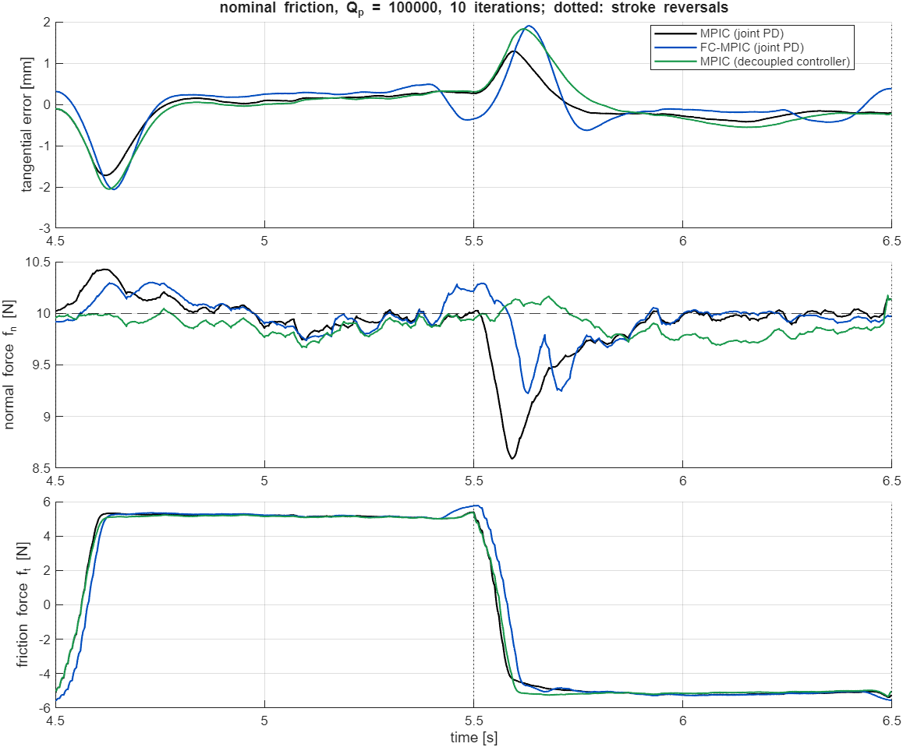
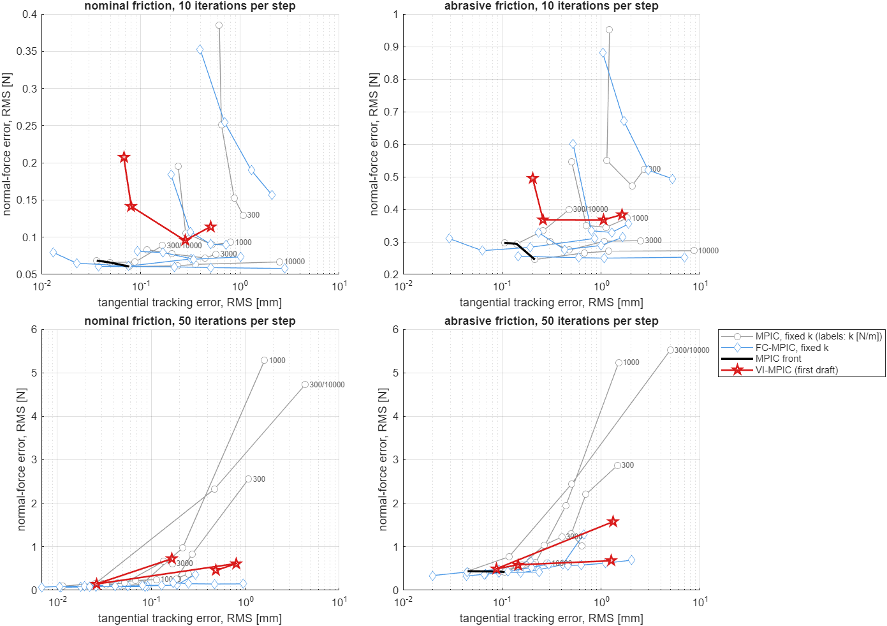

# FC-MPIC for the 2-link robot: implementation and comparison with MPIC and VI-MPIC

This branch implements friction-consistent MPIC (FC-MPIC) from the proposal
*Friction-Consistent Model Predictive Interaction Control* (2 Nov 2026). It then
checks two things on this robot:

1. whether the new parts of the method are right;
2. whether they give an advantage over classical MPIC (Gold et al., T-RO 2023) and over
   VI-MPIC.

VI-MPIC is the first draft of branch `vi-mpic`. The v2 changes are not used, because
they were tuned on this robot.

Code: [`fc_mpic/`](../fc_mpic). Equation and proposition numbers refer to the
proposal. All numbers are in [`fc_mpic/results/`](../fc_mpic/results).

## Answer

**The friction model is right and predicts much better than Gold's. In closed loop
it improves normal-force regulation by a moderate amount, and only when the
low-level controller couples the normal and tangential directions. A simpler change
of the low-level controller removes most of the same problem. VI-MPIC, as drafted,
gives no advantage in this task.**

**1. The model (claims C1, C3).** The model was checked on a plant it does not share:
a rigid-body arm with a LuGre wall and a Stribeck peak.
- The FC model reproduces the plant's friction loop. The normal-force ratio r_n
  (eq. 2.12) is 1.63 in the model and 1.70 in the plant (abrasive: 2.25 vs 2.42).
- The reversal travel (eq. 2.11) is 8.8 mm in the model and 8.0-9.3 mm in the plant.
- The normal-force RMS error over the loop is 0.8 N with the FC model and 2.5 N with
  Gold's model (abrasive: 0.6 N vs 4.3 N).
- Over the MPC horizon, FC predicts friction, normal force and tool position 2-7
  times better at stroke reversals.

**2. The frozen Jacobian.** Both MPIC and FC-MPIC freeze J0 over the horizon. On this
small arm that freeze, not the friction model, dominates the prediction error beyond
about 0.2 s. With J re-linearised along the prediction, FC is 2.6-5 times better than
Gold's model over the whole 0.5 s horizon.

**3. Closed loop, joint PD of Gold et al.** This is the setting the proposal targets.
Each controller trades tangential tracking against normal-force regulation through
the tracking weight. The table compares these trade-off curves: it gives FC-MPIC's
normal-force error at the tangential tracking error of MPIC, as a median over MPIC's
non-dominated points.

| | 10 iterations (real time) | 50 iterations |
|---|---|---|
| all samples, nominal / abrasive | **-25 % / -24 %** | -15 % / -13 % |
| stroke reversals, nominal / abrasive | **-55 % / -59 %** | -6 % / -27 % |

- **The gain is a better trade-off, which can be spent on force or on tracking.**
  - At MPIC's force error, FC-MPIC tracks tighter: median -51 % (nominal) and -30 %
    (abrasive) with 10 iterations, -13 % (nominal) with 50. The curves are flat, so
    this measure is noisy.
  - With the same weights as MPIC, FC-MPIC spends the gain on the force: its
    tangential error is equal or larger.
- **The gain holds for soft and stiff joints** (60, 120 and 400 Nm/rad: -23 to -27 %,
  reversals -55 to -56 %). The normal-force step at a reversal depends only on the
  stiffness ratio k̂_nt / k̂_tt, not on the stiffness level.
- **It does not hold for every task.** With a 3 cm instead of an 8 cm stroke and
  10 iterations, the curves cross: median +1 % overall, -19 % at reversals. With 50
  iterations it is -10 to -18 %.
- **The gain comes only from the coupling.** Without it (FC-nc), FC-MPIC is no
  better than MPIC (+6 to +26 %).
- **The measurement-consistent cone matters.** Without it, half of the gain remains
  with 10 iterations and none with 50.
- **Pure-sliding Coulomb friction is worse than MPIC** (+25 to +52 %).

**4. A simpler alternative competes.** Consider a Cartesian impedance aligned with the
wall that has the same normal and tangential stiffness as the joint PD but no
coupling. With plain MPIC it removes the cause instead of predicting it: the
normal-force dip at reversals disappears.
- Against MPIC on the joint PD it has 12-38 % less force error (24-76 % less at
  reversals).
- Against FC-MPIC on the joint PD it is equal with 50 iterations (-2 % / +2 %).
- With 10 iterations it is better at moderate tracking but degrades at the tightest
  tracking weights.
- Where the controller can be chosen, this is the baseline FC-MPIC must beat.

**5. On VI-MPIC's controller (Cartesian, decoupled), FC-MPIC brings nothing.**
- FC-MPIC equals MPIC with the same stiffness for k ≥ 1000 N/m and the anisotropic
  gain: within -6 to +4 % of continuous-time MPIC and -4 to +24 % of MPIC in discrete
  time.
- With k = 300 N/m it is worse overall (+17 to +41 %) but better at reversals.
- This agrees with the theory: with no coupling there is nothing to model in the
  normal force.

**6. VI-MPIC (first draft) is dominated by fixed-gain MPIC in this task.**
- Every VI-MPIC setting (16 of 16: two cases, two iteration counts, four weights) is
  beaten by at least one fixed-gain MPIC setting in both tracking and force.
- At its own tracking error it has +97 % (abrasive) to +234 % (nominal) more force
  error with 10 iterations, and +14 % with 50 iterations (abrasive).
- It costs 4 times the solve time of MPIC.
- Together with the impact study of the first draft, VI-MPIC as drafted shows no
  advantage on this robot.

**7. The discrete-time formulation itself is a robustness gain, with soft Cartesian
gains.**
- With 50 iterations and soft Cartesian gains, the original continuous-time MPIC
  limit-cycles in sustained sliding: up to 5.5 N RMS, 18-25 N peaks and 6-9 % of the
  time without contact. This is finding 5 of the VI-MPIC v2 study.
- The discrete-time version of the same model, which FC-MPIC needs anyway, does not:
  0.1-1.3 N.
- This gain must not be credited to the friction model, so every closed-loop number
  is also given against MPIC in discrete time.
- With the joint PD there is no such cycle, and discrete-time MPIC is 1-10 % worse
  than continuous-time MPIC. FC-MPIC's gain against it is therefore larger: -27 to
  -32 % with 10 iterations, -15 to -20 % with 50.

**8. Cost and robustness.**
- FC-MPIC takes 2 times the solve time of MPIC: 0.28 vs 0.14 ms with 10 iterations,
  1.38 vs 0.67 ms with 50.
- An over-estimated friction coefficient (0.8 instead of 0.5) makes it 6 times worse
  than with the correct value, and worse than MPIC. The online estimate repairs this
  (it converges to 0.51 from 0.3 and from 0.8).

## Novelty

What the proposal claims as new, against what this study and a literature check
(2 Nov 2026) found:

| claim | status |
|---|---|
| Friction seen through a coupled controller compliance produces reversal travel and a normal-force step, r_n (Prop. 2.4) | **Confirmed and new as a statement about MPIC.** Reproduced on an independent plant. The mechanics is elementary, but no MPIC or force-feedback MPC work found states or exploits it. |
| Return-mapped elasto-plastic friction inside the MPIC prediction, exact for constant inputs (Prop. 2.3), with analytic adjoints | **Works as stated.** Prop. 2.3 holds to machine precision, the adjoints pass GRAMPC's gradient check, and real-time cost is 0.28 ms. The ingredients are textbook (Dahl, LuGre, elasto-plastic models; Simo & Hughes return mapping); the novelty is the combination. |
| Gold's model as a special case; no contact stiffness to identify (Props. 2.1-2.2) | **Confirmed** (μ = 0 recovers Gold's normal force to 0.01 N). |
| Closed-loop gains in tracking and normal force (C4) | **The trade-off improves**: 13-25 % less normal-force error at equal tracking, up to 55-59 % at reversals. This holds only with a coupled low-level controller. At fixed weights the gain goes into the force, not the tracking. A decoupled Cartesian impedance achieves about the same with plain MPIC. |

**Related work missing from the proposal's Table 1.**
- Wijayarathne et al.,
  [Real-Time Deformable-Contact-Aware MPC for Force-Modulated Manipulation](https://arxiv.org/abs/2212.09234)
  (arXiv 2212.09234, journal version of IROS 2020). It is an MPC that models normal
  and sliding-friction forces of a soft contact as a dynamical system, run under
  Cartesian force control. It has no stick phase and no controller compliance, but a
  reviewer will cite it against "no MPC models friction and normal force together".
- The cited [Cufino et al.](https://arxiv.org/abs/2605.25672) and
  [Özcan et al.](https://arxiv.org/abs/2603.12399) preprints exist.
- Nguyen & Righetti (arXiv:2610.17069) could not be confirmed with a web search;
  check it before citing.

**Where a reviewer will push.** "Use a Cartesian impedance aligned with the surface,
and the coupling, the cause of the normal-force error, is gone." On this robot that
alternative is as good as FC-MPIC once the solver converges. The paper needs it as a
baseline, and an argument for when it is not available: joint-impedance-only
interfaces, unknown or curved normals, redundancy. The friction-cone constraint for
stick-critical tasks (E4), which Gold's model cannot express, was not tested here.
It may be the stronger story.

## 1. FC-MPIC for the 2-link arm

The proposal is written for a 7-DOF arm with a 6-D wrench. Here the contact point is
the end effector of the planar arm, the wall has normal +x (as in VI-MPIC), and the
contact force has a friction and a normal component:

    x = [q1 q2 | qd1 qd2 | ft fn],   u = dqd/dt,   phi = (ft, fn) = B' F,   B = [e_y, e_x]

Discrete-time map for GRAMPC's `Integrator = 'discrete'` (proposal eq. 2.13). J0 is
frozen per MPC step (prestep), W = Kd^-1 Kp, G = Kd^-1 J0' B:

    q+   = q + dt [u + W (qd - q) - G phi]
    qd+  = qd + dt u
    phi+ = R_mu(phi, B' J0 u dt)        elastic predictor + smooth plastic corrector, eq. (2.4)-(2.8)

The stick stiffness is K̂ = (B' C B + D)^-1 with C = J0 Kp^-1 J0' and
D = diag(0, 1/k_n): rigid tangential contact, and the wall stiffness k_n = 5000 N/m
known, as in VI-MPIC. Further details:

- **Corrector.** The smooth corrector uses β = 4 1/N and ε_f = 0.3 N, the proposal's
  values.
- **Friction coefficient.** μ_k is the measurement-consistent value of eq. (2.9),
  computed from the measured force when f_n > 2 N. The online estimate of eq. (2.10)
  uses gain 0.05 and sliding speed > 2 cm/s.
- **Gate.** Before contact, and after a loss of contact, φ is held (measured gate).
- **Painlevé condition.** μ_k is capped below the condition k̂_tt > μ |k̂_nt| of
  Prop. 2.3 as a safeguard. The cap was active in none of the 1752 runs.
- **Adjoints.** The adjoints are those of Appendix A, written with W' so that they
  hold for any Kd; here W = omega I. They pass GRAMPC's gradient check
  for every model, gate and time mode, including states with almost no contact force,
  where the last term of eq. (A.5) matters (`check_fc_gradients.m`). A mutation test
  confirmed that the check catches a sign error in that term.

**The same problem file runs the baselines** (`probfct_FC_MPIC.c`, `UP_MODEL`):

| model | force row |
|---|---|
| 0, Gold et al. (classical MPIC) | dfn/dt = kbar_n (B' J0 u)_n with kbar_n = 1 / (n' C n + 1/k_n), friction held at its measured value; continuous time (`UP_DISC = 0`, the original) or discrete time |
| 1, FC-MPIC | return map above; ablations: coupling removed (B' C B diagonal), no measurement-consistent cone |
| 2, pure sliding (Kleff et al.) | fn as model 0, ft = mu fn tanh(r_t / 5 mm/s) |

Continuous-time MPIC in this file reproduces the fixed-gain MPIC of
`probfct_VI_MPIC.c` in closed loop (3 s: |Δp| ≤ 3e-9 m, |ΔF| ≤ 6e-6 N), so `mpic`
here is the MPIC of the VI-MPIC study.

**Cost**, the same for all controllers. These are the terms of the VI-MPIC study,
with the velocity feed-forward of Gold et al. (Sec. III-D):

    l = 1/2 (Qp_y (py - py*(t))^2 + QF (fn - fn*)^2 + RQ |u - u*(t)|^2),   u* = J0^-1 (0, dpy*/dt)

QF = 0.5 1/N² and RQ = 0.01. Qp_y is swept over 5e3, 2e4, 1e5 and 5e5 1/m², and in
the joint set also 2e6 and 1e7, to trace each controller's trade-off curve. In
discrete time the stage cost is multiplied by dt, so the sum approximates the
integral. The friction force is not weighted.

**VI-MPIC needed two additions to run this task:**
- a stroke target and the feed-forward in `probfct_VI_MPIC.c`. These are new
  `userparam` entries that default to zero; with them at zero, the first-draft
  benchmark is reproduced to six digits.
- the measured friction force in its force state. VI-MPIC holds it frozen, as Gold et
  al. do.

Everything else is `vi_params` and the per-step logic of `vi_simulate`: belief update,
conditioned gate and risk cost.

## 2. Benchmark

**Plant.** The rigid-body arm of the VI-MPIC study:
- two links of 0.2 m and 0.5 kg in the horizontal plane, Coriolis terms compensated,
  integrated at 0.2 ms;
- under the joint PD law of Gold et al. eq. (4), with Kd = Kp/omega and omega = 10 1/s;
- pressing on the wall x = 0.30 m, a spring-damper of 5000 N/m and 10 Ns/m;
- LuGre friction with a Stribeck peak along the wall (sigma0 = 3e4 N/m,
  sigma1 = 30 Ns/m, sigma2 = 2 Ns/m, v_s = 1 cm/s), the parameters of the proposal's
  prototype;
- the contact force measured with Gaussian noise at 100 Hz; the joints measured
  exactly.

**Task.** The end effector starts in static contact, pressing F_des = 10 N, and performs
sanding strokes along the wall, py* = y0 + A (1 - cos(2 pi (t - 0.5 s)/T)), with
A = 4 cm (8 cm strokes), for 6.5 s. The two friction cases follow the proposal:

| case | μ_c / μ_s | stroke period | force noise |
|---|---|---|---|
| nominal | 0.5 / 0.6 | 2 s | 0.1 N |
| abrasive | 0.8 / 0.9 | 1.2 s | 0.5 N |

F_des and the joint stiffness were chosen so that the reversal travel (8.8 mm) and r_n
(1.63) are of the same order as the prototype's (6.1 mm, 1.69).

**Metrics**, after 0.5 s, from the 1 kHz plant log:
- the RMS of the tangential tracking error py - py* and of the normal-force error
  fn - F_des, overall and in the reversal windows (|dpy*/dt| below 40 % of its peak);
- the largest error and the time without contact.

**MPC.** GRAMPC 2.3, dt = 10 ms, horizon 0.5 s:
- continuous time on 26 points, as in the VI-MPIC study, or discrete time on 51
  points;
- 10 gradient iterations per step (real time) and 50.

Each setting was run with 3 noise seeds; every controller sees the same noise. In all
there are 1752 closed-loop runs.

**Low-level controllers.**

| set | Kp | coupling |
|---|---|---|
| joint | diag(120, 120) Nm/rad (also 60 and 400): a joint-diagonal PD like the original MPIC of this repository, which uses 1000 Nm/rad | k̂_nt / k̂_tt = 0.48 at the stroke centre |
| decoupled | Cartesian, J0' diag(8975, 1005) J0 N/m: the normal and tangential stiffness of the joint PD at the start pose | none |
| cart | Cartesian, J0' diag(k) J0, k = 300 ... 10000 N/m and 300/10000 N/m, the controller of VI-MPIC | none |

## 3. Results

### 3.1 The friction loop (E1, Prop. 2.4)

Here the normal reference is held while the tangential reference moves ±20 mm at
1 cm/s. The FC model (exact return map on the reference increments) is compared with
the plant (`check_fc_model.m`):



| case | r_n plant / FC model (eq. 2.12) | reversal travel plant / FC / eq. (2.11) [mm] | f_n RMS error FC / Gold [N] | f_t RMS error FC [N] |
|---|---|---|---|---|
| nominal | 1.70 / 1.63 | 8.0-9.3 / 8.8 / 9.2 | 0.81 / 2.54 | 0.63 |
| abrasive | 2.42 / 2.25 | 15.2-17.7 / 15.6 / 16.4 | 0.60 / 4.33 | 0.77 |

The plant's sliding levels curve because the arm's configuration changes along the
stroke, while the model keeps K̂ of the start pose. Prop. 2.3 holds: one exact
return-map step equals 20000 sub-steps to six digits.

### 3.2 Prediction over the horizon (proposal Sec. 3.2)

Along closed-loop runs (joint PD, Qp_y = 1e5, 10 iterations, driven by FC-MPIC), each
model is rolled out with the inputs actually applied (`fc_prediction.m`). Results
driven by MPIC are within 10 %. RMS error, nominal case:

| model | tool position [mm], 0.1 / 0.3 / 0.5 s | friction [N] | normal force [N] | reversals at 0.3 s: position / friction / normal force |
|---|---|---|---|---|
| Gold et al. | 1.01 / 3.35 / 5.00 | 2.73 / 5.17 / 6.81 | 1.16 / 5.09 / 11.15 | 5.97 / 8.54 / 5.28 |
| pure sliding | 0.90 / 2.45 / 5.70 | 1.93 / 3.05 / 5.82 | 1.16 / 5.09 / 11.15 | 2.93 / 2.48 / 5.28 |
| FC-nc | 0.62 / 2.36 / 5.99 | 1.42 / 2.89 / 5.95 | 1.16 / 5.09 / 11.15 | 2.49 / 2.67 / 5.28 |
| **FC** | **0.63 / 2.02 / 5.07** | **1.32 / 2.70 / 5.67** | **0.81 / 4.68 / 10.52** | **1.47 / 1.21 / 2.58** |
| Gold, J(q) updated | 1.02 / 3.48 / 5.22 | 2.73 / 5.17 / 6.81 | 0.97 / 2.21 / 3.03 | 6.41 / 8.54 / 3.82 |
| FC, J(q) updated | 0.61 / 0.91 / 1.03 | 1.29 / 1.29 / 1.43 | 0.51 / 1.01 / 1.18 | 1.27 / 0.59 / 1.21 |



- **In the first 0.1-0.3 s and at reversals, FC predicts much better**, as the
  proposal claims: 4 times better tool position, 7 times better friction and 2 times
  better normal force at reversals after 0.3 s.
- **Over the whole horizon, every model with a frozen J0 drifts.** After 0.5 s the
  normal-force error is about 11 N for every model, because an 8 cm stroke is 20 % of
  this arm's reach.
- **The "J(q) updated" rows separate the two error sources.** They re-linearise the
  model along the predicted joints; this is an analysis tool, not a controller. FC
  then predicts 2.6-5 times better than Gold's model over the full horizon.
- **Consequence.** On this arm the friction model's accuracy is largely hidden behind
  the frozen Jacobian that FC-MPIC inherits from MPIC. The proposal's prototype
  (a 1 m arm, 8 cm strokes) is less affected.

### 3.3 Closed loop with the joint PD

Each curve sweeps the tracking weight Qp_y; lower left is better. The green curve is
MPIC with the decoupled controller (section 3.4).



At stroke reversals:



The table gives the change of the normal-force error at the tracking error of the
reference's non-dominated points: median [min, max] (number of points). Negative is
better. `fc_report.m` prints every point.

| controller | 10 it, nominal | 10 it, abrasive | 50 it, nominal | 50 it, abrasive |
|---|---|---|---|---|
| FC-MPIC vs MPIC | **-25 %** [-31, -24] (6) | **-24 %** [-27, +64] (5) | **-15 %** [-23, -8] (4) | **-13 %** [-14, -12] (2) |
| ... at reversals | -55 % [-60, -31] (3) | -59 % [-66, -39] (5) | -6 % [-7, +10] (3) | -27 % (1) |
| FC-MPIC vs MPIC in discrete time | -32 % [-37, -23] (5) | -27 % [-28, -21] (3) | -20 % [-21, -16] (5) | -15 % (2) |
| FC-MPIC without coupling vs MPIC | +26 % [+10, +42] (6) | +6 % [+3, +125] (5) | +8 % [-5, +16] (4) | +11 % [+8, +14] (2) |
| FC-MPIC without consistent cone vs MPIC | -14 % [-24, -9] (3) | -13 % [-17, -12] (3) | -0 % (1) | n/a |
| pure sliding vs MPIC | +52 % [+15, +89] (2) | +25 % [-7, +43] (3) | n/a | n/a |
| MPIC in discrete time vs MPIC | +10 % [-9, +13] (5) | +1 % [-26, +4] (5) | +6 % [-7, +13] (4) | +3 % [+1, +4] (2) |

Worst normal-force RMS over the four base weights (5e3 ... 5e5): MPIC 0.37 / 0.79 /
0.25 / 0.70 N, FC-MPIC 0.22 / 0.53 / 0.15 / 0.48 N (same column order). No run lost
contact.

**Sensitivity.** FC-MPIC against MPIC, normal-force error at MPIC's tracking:

| | 10 it, all | 10 it, reversals | 50 it, all | 50 it vs MPIC in discrete time |
|---|---|---|---|---|
| joints 60 Nm/rad | -23 % | -56 % | -8 % (1 point) | -22 % |
| joints 120 Nm/rad | -25 % | -55 % | -15 % | -20 % |
| joints 400 Nm/rad | -27 % | -56 % | -45 % (1 point) | -12 % |
| 3 cm stroke, nominal | +1 % [-17, +112] | -19 % | -18 % | -21 % |
| 3 cm stroke, abrasive | -12 % [-24, +73] | +17 % [-25, +360] | -10 % | -12 % |

Time histories over one stroke period (nominal, Qp_y = 1e5, 10 iterations):



At the reversal at 5.5 s:
- MPIC's normal force drops by 1.4 N. This is the coupling: the friction reverses,
  the controller spring is rewound tangentially, and with it normally.
- FC-MPIC raises the force just before the reversal and halves the dip.
- With the decoupled controller there is no dip.
- The tangential errors at reversals are similar for all three.

The abrasive case: [figures/fc_runs_abrasive.png](figures/fc_runs_abrasive.png).

### 3.4 Decoupling the controller instead of modelling the coupling

| | 10 it, nominal | 10 it, abrasive | 50 it, nominal | 50 it, abrasive |
|---|---|---|---|---|
| MPIC, decoupled vs MPIC, joint PD | -38 % (rev -76 %) | -23 % (rev -27 %) | -12 % (rev -35 %) | -13 % (rev -24 %) |
| MPIC, decoupled vs FC-MPIC, joint PD | +34 % [-24, +153] | -0 % [-12, +10] | +2 % [-5, +9] | -2 % [-4, +1] |
| FC-MPIC, decoupled vs FC-MPIC, joint PD | +5 % | +28 % | -23 % | -7 % |

- **At moderate tracking**, the decoupled controller with MPIC has the lowest force
  errors of all controllers (green curves above).
- **At the tightest tracking weights with 10 iterations it degrades sharply.** This is
  where the wide range in the first column comes from.
- **With 50 iterations it equals FC-MPIC on the joint PD.**
- **FC-MPIC on the decoupled controller has only the stick-slip part left.** It is
  the best controller with 50 iterations in the nominal case, but not with 10.

### 3.5 The controller of VI-MPIC, and VI-MPIC itself



| | 10 it, nominal | 10 it, abrasive | 50 it, nominal | 50 it, abrasive |
|---|---|---|---|---|
| FC-MPIC vs MPIC, same k ≥ 1000 N/m | -2 ... +0 % | +1 ... +4 % | no overlap | no overlap |
| FC-MPIC vs MPIC, k = 300 N/m (rev) | +28 % (-56 %) | +41 % | -35 % | n/a |
| VI-MPIC vs fixed-gain MPIC, at VI-MPIC's tracking | +234 % | +97 % | no overlap | +14 % |
| VI-MPIC settings beaten in both metrics by a fixed-gain MPIC setting | 4 of 4 | 4 of 4 | 4 of 4 | 4 of 4 |

Best values over all weights:

| | 10 it, nominal | 10 it, abrasive | 50 it, nominal | 50 it, abrasive |
|---|---|---|---|---|
| fixed-gain MPIC: tracking [mm] / force [N] | 0.036 / 0.061 | 0.106 / 0.246 | 0.012 / 0.095 | 0.045 / 0.416 |
| VI-MPIC: tracking [mm] / force [N] | 0.068 / 0.096 | 0.204 / 0.367 | 0.026 / 0.145 | 0.087 / 0.492 |

**What VI-MPIC does.** It softens the normal direction (to about 560 N/m in a typical
run) and keeps the tangential direction stiff, as its risk cost dictates. Fixed
anisotropic or stiff gains still do better.

**Limit cycle of continuous-time MPIC (50 iterations).** Worst normal-force RMS over
the base weights, nominal:

| k [N/m] | MPIC, continuous (original) | MPIC, discrete | FC-MPIC |
|---|---|---|---|
| 300 | 2.56 N | 0.17 N | 0.17 N |
| 1000 | 5.29 N (18.6 N peak, 7 % without contact) | 0.35 N | 0.37 N |
| 3000 | 0.67 N | 0.12 N | 0.12 N |
| 300/10000 | 4.73 N (22.4 N peak, 7 % without contact) | 0.13 N | 0.13 N |

- **Where it comes from.** The cycle appears only at low tracking weights with the
  continuous-time model. It is not caused by the coarse 26-point grid: 51 points give
  the same result.
- **One cause** is that the continuous formulation predicts with linearly
  interpolated controls, while the plant holds the first control over the sampling
  interval. Applying the planned ramp instead removes the cycle at Qp_y = 2e4
  (1.2 → 0.34 N), but not at 5e3.
- **This is finding 5 of the VI-MPIC v2 study.** It is a property of the continuous
  formulation, not of the force model.

### 3.6 Unknown friction coefficient

Joint PD, nominal case (true μ_c = 0.5), Qp_y = 2e4, normal-force error RMS / at
reversals [N]:

| controller | 10 iterations | 50 iterations | final estimate |
|---|---|---|---|
| MPIC | 0.259 / 0.420 | 0.222 / 0.246 | - |
| FC-MPIC, μ = 0.5 | 0.180 / 0.128 | 0.129 / 0.158 | - |
| FC-MPIC, μ = 0.3 | 0.204 / 0.138 | 0.142 / 0.196 | - |
| FC-MPIC, μ = 0.3, estimated | 0.183 / 0.130 | 0.132 / 0.154 | 0.516 |
| FC-MPIC, μ = 0.8 | **1.109** / 0.381 | **0.888** / 0.270 | - |
| FC-MPIC, μ = 0.8, estimated | 0.208 / 0.136 | 0.154 / 0.156 | 0.514 |

This agrees with the proposal (Table 4):
- under-estimating μ is nearly harmless, because the measurement-consistent cone
  lifts it;
- over-estimating μ is worse than MPIC;
- the online estimate fixes both.

### 3.7 Solve time

GRAMPC time per MPC step, one controller at a time (`fc_timing.m`), median [ms]:

| | MPIC | MPIC, discrete | FC-MPIC | pure sliding | VI-MPIC |
|---|---|---|---|---|---|
| 10 iterations | 0.14 | 0.16 | 0.28 | 0.17 | 0.57 |
| 50 iterations | 0.67 | 0.77 | 1.38 | 0.82 | 2.76 |

FC-MPIC costs 2 times MPIC: twice the grid points of the 26-point continuous problem,
plus the corrector. It stays far below the 10 ms sampling time.

## 4. Findings

1. **The FC model is right; its closed-loop benefit is smaller than its prediction
   benefit.**
   - The model predicts the friction loop, the reversal travel and r_n of an
     independent LuGre plant (section 3.1).
   - Its prediction errors are 2-7 times smaller than Gold's at reversals.
   - In closed loop, force feedback at 100 Hz corrects much of Gold's error after the
     fact. FC-MPIC therefore gains 13-25 % in normal-force RMS at equal tracking, and
     55-59 % at reversals with real-time iterations.
   - The proposal's prototype found a similar normal-force gain (15-31 %). It also
     found 37-56 % less tangential error at reversals at fixed weights, which this
     study does not reproduce: here, at fixed weights, the gain goes into the force.
2. **The benefit needs the coupling.**
   - Without it (FC-nc, or VI-MPIC's decoupled Cartesian controller), FC-MPIC equals
     MPIC.
   - The normal-force step k̂_nt ℓ_rev = 2 μ f_n k̂_nt / (k̂_tt + μ k̂_nt) depends only
     on the stiffness ratio. That is why the gain does not shrink with stiffer joints
     (60-400 Nm/rad).
3. **The coupling can be removed at the low level.** A Cartesian impedance aligned with
   the surface removes the force dip at reversals with plain MPIC and matches FC-MPIC
   once the solver converges (section 3.4).
4. **The frozen Jacobian limits FC-MPIC on this arm.** With J0 frozen over 0.5 s and
   8 cm strokes on a 0.4 m arm, the linearisation error overtakes the friction model
   after about 0.2 s (section 3.2). A model re-linearised along the prediction would
   carry FC's 2.6-5 times better prediction over the whole horizon. This needs
   K̂(q) and its derivative in the adjoint.
5. **Discretisation can matter as much as the friction model.**
   - The discrete-time map that FC-MPIC needs anyway removes the force limit cycle of
     converged continuous-time MPIC with soft Cartesian gains (section 3.5).
   - A fair paper must compare against MPIC in discrete time, so that this effect is
     not credited to the friction model.
   - With the joint PD it does not inflate the result: there, discrete-time MPIC is
     1-10 % worse than continuous-time MPIC.
6. **Real-time iterations favour FC-MPIC.** With 10 iterations its gains are about
   twice those with 50. Report the solver convergence with every closed-loop number
   (as for VI-MPIC).
7. **Short strokes and aggressive tracking weights are weak spots.**
   - With 3 cm strokes and 10 iterations, FC-MPIC's trade-off curve crosses MPIC's.
   - At the two largest tracking weights in the abrasive case, FC-MPIC's force error
     grows faster than MPIC's (the +64 % in the range above).
8. **VI-MPIC (first draft) is dominated by fixed-gain MPIC** in this task, as in the
   impact task of the first draft. Its stiffness planning softens the normal
   direction, but a fixed stiff or anisotropic gain tracks and regulates better at a
   quarter of the solve time.

**What this means for the IROS plan.**
- Lead with the model: E1 and prediction accuracy (C1, C3). They are strong and hold
  on an independent plant.
- State C4 as "normal-force regulation at reversals", with trade-off curves rather than
  one weight. Include MPIC in discrete time and MPIC with a surface-aligned Cartesian
  impedance as baselines.
- Make E4 (the friction-cone constraint for stick-critical tasks) a main experiment.
  It is the capability no baseline has.
- Consider re-linearising J along the horizon.
- Add Wijayarathne et al. to the related work, and verify every 2026 preprint cited.

**Limitations.**
- A planar toy arm (0.4 m reach), one flat wall, a point contact, equal joint gains
  (one coupling ratio).
- The LuGre plant with a known Coulomb level (except section 3.6), Gaussian force
  noise, exact joint measurements.
- Quasi-static prediction models in every controller.
- GRAMPC's real-time gradient method (10 or 50 iterations), not the converged
  Gauss-Newton of the prototype.
- One force weight (only the tracking weight was swept).
- The friction-cone constraint was not implemented.
- No hardware.

## Reproduce

In MATLAB, from `fc_mpic/` (see [`fc_mpic/README.md`](../fc_mpic/README.md)):

```matlab
fc_build                  % +CmexFC and +CmexVI
check_fc_gradients        % adjoints against finite differences
check_fc_model(true)      % E1 friction loop, Props. 2.1/2.3, mirror and equivalence checks
fc_prediction(true)       % prediction accuracy over the horizon
for it = [10 50]
    for s = {'joint', 'joint_hi', 'kq', 'cart', 'cart_d', 'mu', 'decoupled', 'stroke'}
        run_fc_benchmark(s{1}, it);
    end
end
fc_report(true)           % tables and docs/figures/fc_pareto_*.png
fc_plot_runs('nominal', 1e5, 10, '../docs/figures/fc_runs_nominal.png')
fc_timing                 % solve times, with no other MATLAB job running
```

The 1752 runs take about 15 minutes in four parallel MATLAB processes.
