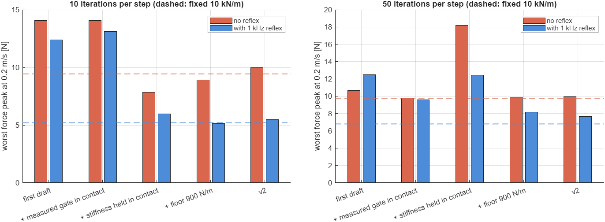
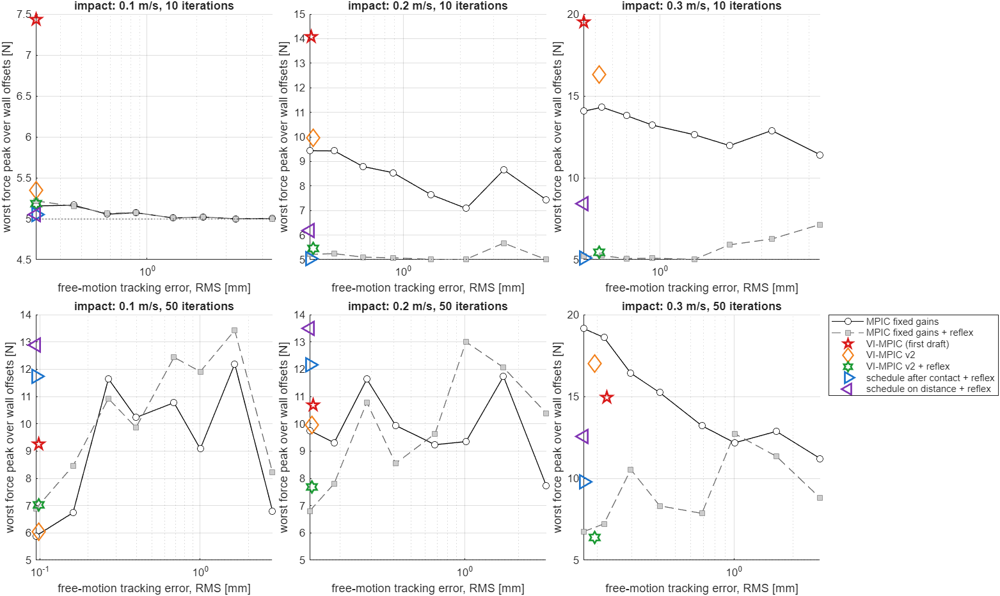
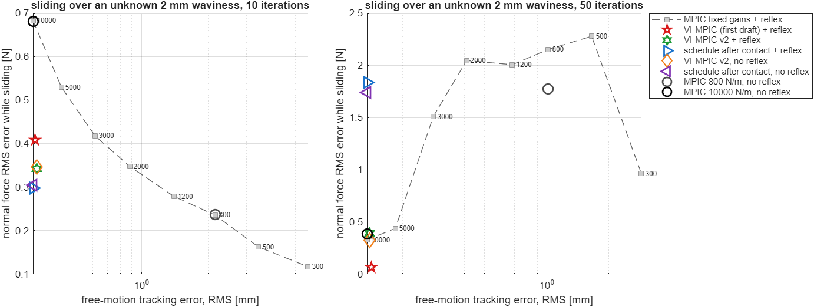
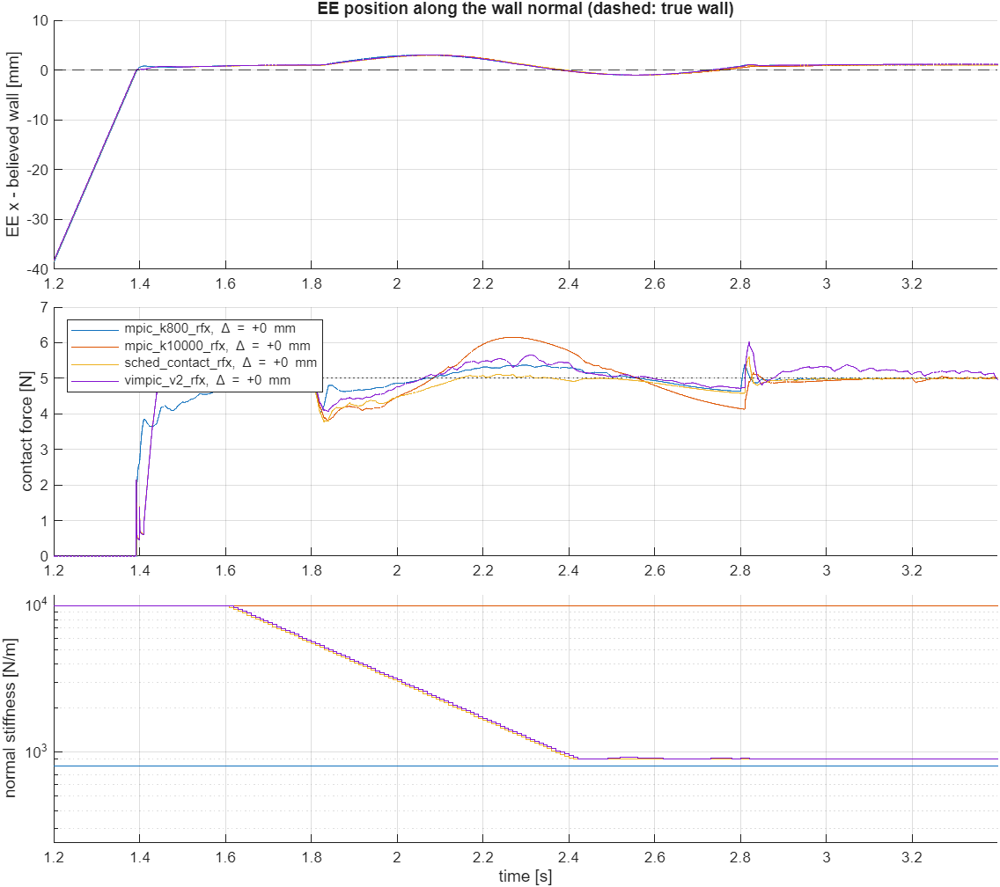
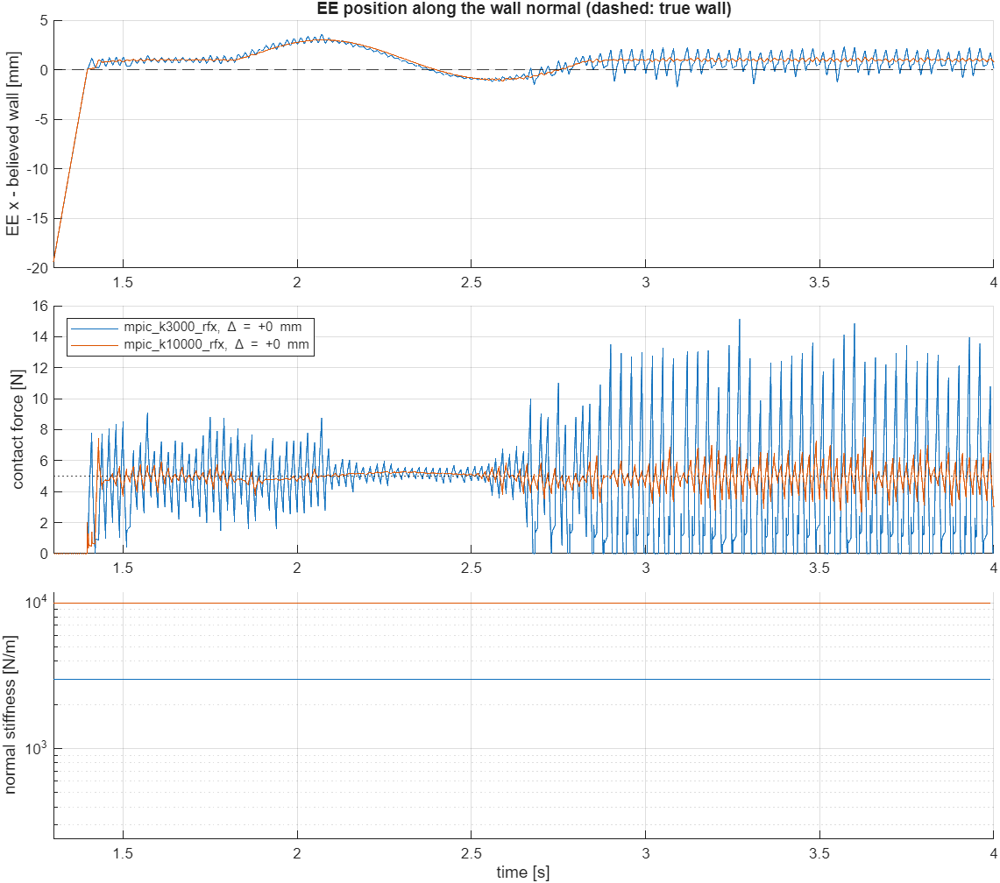

# VI-MPIC v2: what makes it better, and what does not

This branch continues [the first draft](vi-mpic.md). The first draft found that
VI-MPIC, as drafted from the formulation notes, lies *above* the fixed-gain Pareto
front on this robot. This round finds out why, changes the controller step by
step, and tests the result on two tasks: the impact task of the first draft, and
the sliding task E3 of the notes, which the first draft did not cover.

Code: [`vi_mpic/`](../vi_mpic) (the v2 options are in `vi_simulate.m` and
`vi_variants.m`). All numbers are in [`vi_mpic/results/`](../vi_mpic/results)
(`v2_*.csv`).

## Answer

**VI-MPIC can be made much better, and v2 now beats the fixed-gain trade-off in
the task where variable stiffness matters. Most of the gain on impacts, however,
comes from a change of the low-level loop that helps every controller, and a
simple schedule matches v2 on this robot.**

- **Impact, real-time setting** (10 iterations per step, the same 0.33 mm
  free-motion tracking): v2 with the reflex keeps the worst force peak at
  5.2 / 5.5 / 5.4 N at 0.1 / 0.2 / 0.3 m/s. The first draft reaches
  7.4 / 14.1 / 19.5 N (F_des = 5 N). With 50 iterations v2 has 7.0 / 7.7 / 6.4 N,
  the first draft 9.2 / 12.5 / 11.9 N.
- **Sliding over an unknown 2 mm waviness** (the sanding scenario E3, 10
  iterations): v2 tracks like the stiffest fixed gain (0.33 mm) and halves its
  normal-force error while sliding (0.34 N against 0.68 N). To get 0.34 N a fixed
  gain needs about 2000 N/m, and then tracks 2.7 times worse. v2 lies clearly
  below the fixed-gain front.
- **Solve time** with 10 iterations is 0.46 ms median, against 0.66 ms for the
  first draft and about 0.4 ms for classical MPIC.

**What made the difference.** The improvement ladder at 0.2 m/s, 10 iterations,
gives the worst force peak after each change:

1. **No stiffness actuation during the impact** (hold 0.2 s after contact, then
   at most 3 1/s): 14.1 -> 7.8 N. This is the key VI-specific fix (section 1).
2. **A 1 kHz contact reflex** in the low-level loop, which stops the reference
   when contact appears between two MPC samples. It helps every controller: the
   fixed 10 kN/m gain drops from 9.4 to 5.2 N, v2 from 10.0 to 5.5 N.
3. **Measured gate in contact and a contact-aware floor.** Both are needed once
   the solver converges: without the floor, holding the stiffness gives 18.2 N
   at 50 iterations.
4. **Force risk only in contact.** With the reflex, softening before contact
   only hurts, so v2 stays stiff until contact and softens afterwards. This keeps
   v2 robust at 50 iterations (7.7 N against 8.2-12.5 N for the variants that
   soften before contact).

**How v2 compares with simple baselines on this robot.**
- **Impact:** with the reflex, the stiff fixed gain of classical MPIC is as good as
  v2 (5.2 N against 5.2-5.5 N with 10 iterations, 6.7-6.9 N against 6.4-7.7 N
  with 50). Once the reflex exists, stiffness planning adds nothing at impact.
- **Sliding:** a hand-made schedule (stiff until contact, hold, soften at 3 1/s
  to 900 N/m) is as good as v2 (0.30 N against 0.34 N). This is structural, not a
  tuning accident. For a wall much stiffer than the controller, Proposition 3 of
  the notes puts the optimum of the stiffness cost in contact at
  k* = q_p σ_w² / (q_F σ² k_e³) ≈ 2 N/m, i.e. at the floor. VI-MPIC therefore
  always plans "soften as fast as allowed", which a switch reproduces. Its
  optimisation does more than a switch only for soft environments: here
  k_e < 650 N/m.
- **Robustness:** with 50 iterations, the force loop of the quasi-static MPIC
  model limit-cycles in sustained contact for every contact stiffness up to
  3000 N/m, for classical MPIC and VI-MPIC alike. Only the 10 kN/m gain stays
  stable, and a 10 or 100 times larger input weight does not help. The
  real-time iteration hides this by not converging. It is the most important
  open issue of the MPIC force model (finding 5).

**Recommended approach:**
- put the contact reflex in the 1 kHz loop;
- use v2's stiffness logic: stiff in free motion and at impact, no stiffness
  change during the impact transient, soften slowly in sustained contact,
  measured gate in contact, contact-aware floor;
- compare against the stiff gain with reflex and the contact schedule before
  claiming an advantage;
- add the contact lag to the force model before relying on converged solves.

## 1. Why the first draft hit harder: diagnosis

The fine logs of the plant (0.2 ms) around the first contact, at 0.2 m/s with
10 iterations, show the reference velocity along the normal at the first two
MPC steps after the impact:

| controller | reference velocity after contact | force peak | time of the peak after touch |
|---|---|---|---|
| MPIC, 300 and 10000 N/m | -0.044 to +0.006 m/s at the next MPC step | 4.8-9.4 N | 7-9 ms (spike) |
| VI-MPIC, first draft | +0.11 to +0.20 m/s, then up to +0.18 m/s | 9.2-14.1 N | 11-26 ms |
| VI-MPIC v2 + reflex | reference stopped at touch by the reflex | 4.9 N (no overshoot) | - |

**Fixed gains** stop the reference at the next MPC sample (|v| <= 0.044 m/s). For
a stiff gain, the peak then depends mainly on how long the reference runs on into
the wall before that sample (10 kN/m: 9.4 N after 7.6 ms, 5.1 N after 2.6 ms). For
a soft gain the inertial spike adds to it. This explains why the worst case over
the wall offsets depends on the sampling phase.

**VI-MPIC** keeps pushing at full approach speed for two more steps, for two
reasons:

1. **The probabilistic gate in contact under-predicts the force rate.** Right after
   touch the reference is only about 1 mm past the estimated surface, which has
   sigma_meas = 1 mm. So gamma is about 0.6-0.9, and the model expects the force
   to build slower than it does.
2. **Push and soften.** The risk cost keeps softening in contact. Through the term
   w ⊙ ṡ the model expects the softening to cancel the push. In the plant the push
   acts at once and the softening only after the arm has moved back.

## 2. Changes

Each change is an option in `vi_simulate.m`, so it can be switched on alone (the
`vimpic_*` ladder in `vi_variants.m`):

| change | option | targets |
|---|---|---|
| measured gate (gamma = 1) once contact is measured; the probabilistic gate is used only before contact | `contact_gate = 'measured'` | reason 1 |
| no stiffness actuation during the impact transient: held for 0.2 s after the first contact, then at most 3 1/s | `k_hold`, `k_hold_time`, `k_rate` | reason 2, finding 1 of the first draft |
| contact-aware stiffness floor 900 N/m (zeta >= 1 against the 5000 N/m wall needs 864 N/m) | `P.k_min = 900` | finding 6 |
| force risk of eq. (30) only in contact, with sigma = 2 mm of unknown surface variation along the path, instead of the position belief before contact | `risk_contact_only`, `sigma_contact` | findings 4 and 7 |
| force state reset to 0 after a loss of contact, instead of k̄ g(m_k) | `init_fix` | finding 5 |
| **1 kHz contact reflex** in the low-level loop: when the force crosses the contact threshold inside an MPC interval that was planned without contact, the torque loop stops the reference and the stiffness at that instant, instead of driving on until the next MPC sample | `reflex` (`*_rfx` variants) | the detection delay that sets the impact peak |

**VI-MPIC v2** (`vimpic_v2`) has all model changes; `vimpic_v2_rfx` adds the
reflex. The reflex is a change of the low-level loop, not of the MPC, so every
baseline is also run with it. For a fair test of the stiffness planning, v2 is
also compared with `sched_contact`, a hand-made schedule that does what v2 ends
up doing: stiff until contact, hold for 0.2 s, then soften at 3 1/s to 900 N/m.

**Sliding task** (E3 of the notes, `task = 'slide'`). After the force has settled
(0.4 s after the first contact) the tangential target moves 5 cm along the wall at
5 cm/s while the controller keeps 5 N. The wall has a sinusoidal waviness of 2 mm
amplitude and 5 cm wavelength that the controller does not know. Metrics: the
normal-force RMS error while sliding (except its first 0.1 s), next to the
free-motion tracking error and the impact peak of the same run.

## 3. Results

Impact task as in the first draft: 3 approach speeds, 9 wall offsets within ±2σ,
10 and 50 iterations. Sliding task: 0.2 m/s approach, 5 wall offsets, 10 and 50
iterations. Every controller uses the same weights. The four sweeps ran in
parallel MATLAB processes, so the solve times are slightly inflated, equally for
all controllers.

### 3.1 Improvement ladder (impact)

Worst force peak [N] at 0.1 / 0.2 / 0.3 m/s. Brackets: runs (of 27) in which the
force is not settled at 5 N at the end (RMS error above 1 N over the last 0.5 s):

| controller | 10 it | 10 it + reflex | 50 it | 50 it + reflex |
|---|---|---|---|---|
| VI-MPIC, first draft | 7.4 / 14.1 / 19.5 | 6.6 / 12.4 / 17.6 | 9.2 / 10.7 / 14.9 (1) | 9.2 / 12.5 / 11.9 |
| + measured gate in contact | 7.5 / 14.1 / 19.5 | 6.5 / 13.1 / 17.6 | 7.6 / 9.8 / 14.4 | 9.1 / 9.6 / 12.8 |
| + stiffness held in contact | 5.0 / 7.8 / 13.6 | 5.0 / 6.0 / 8.0 | 12.4 / 18.2 / 17.8 (4) | 9.7 / 12.5 / 12.6 (1) |
| + floor 900 N/m | 5.1 / 8.9 / 13.3 | 5.1 / 5.1 / 5.0 | 7.4 / 9.9 / 14.6 | 11.2 / 8.2 / 9.1 |
| **v2** (+ force risk only in contact, slow softening after 0.2 s, reset) | 5.3 / 10.0 / 16.3 | **5.2 / 5.5 / 5.4** | 6.0 / 10.0 / 17.0 | **7.0 / 7.7 / 6.4** |
| schedule on distance | 5.0 / 8.9 / 12.9 | 5.1 / 6.2 / 8.4 | 11.9 / 12.1 / 12.4 (1) | 12.9 / 13.5 / 12.6 |
| schedule after contact | 5.0 / 9.4 / 14.1 | 5.0 / 5.0 / 5.1 | 8.2 / 10.9 / 19.2 (1) | 11.7 / 12.1 / 9.8 (3) |
| MPIC, 300 N/m | 5.0 / 7.4 / 11.4 | 5.0 / 5.0 / 7.1 | 6.8 / 7.7 / 11.2 | 8.2 / 10.4 / 8.8 |
| MPIC, 800 N/m | 5.0 / 7.1 / 12.0 | 5.0 / 5.0 / 5.9 | 9.1 / 9.3 / 12.2 (1) | 11.9 / 13.0 / 12.7 (2) |
| MPIC, 3000 N/m | 5.1 / 8.8 / 13.8 | 5.1 / 5.1 / 5.1 | 11.6 / 11.6 / 16.4 (5) | 10.9 / 10.8 / 10.5 (7) |
| MPIC, 10000 N/m | 5.2 / 9.4 / 14.1 | 5.2 / 5.2 / 5.2 | 5.9 / 9.8 / 19.2 | 6.9 / 6.8 / 6.7 |

All VI variants and the schedules track like the stiffest gain (0.32-0.33 mm at
0.2 m/s with 10 iterations, 0.13-0.15 mm with 50).

Without a reflex, the most robust VI variant is the anticipatory one (+ floor,
which softens before contact). It matches or beats the stiff fixed gain at 0.2
and 0.3 m/s: 8.9 / 13.3 N against 9.4 / 14.1 N with 10 iterations, 9.9 / 14.6 N
against 9.8 / 19.2 N with 50. Without the floor it is better with 10 iterations
(7.8 N) but fails with 50 (18.2 N). With the reflex, v2 is the most robust
controller next to the stiff fixed gain.

### 3.2 Impact: the fixed-gain front with and without the reflex

With 10 iterations the reflex moves the whole fixed-gain front down to about 5 N:
the impact trade-off that VI-MPIC was meant to remove disappears. With 50
iterations every controller is noisier, and v2 with the reflex is the best of all
at 0.3 m/s (6.4 N).

### 3.3 Sliding over an unknown waviness

10 iterations (5 wall offsets; RMS error mean and worst over the offsets):

| controller | tracking [mm] | impact peak worst [N] | sliding force RMS mean (worst) [N] | worst deviation [N] | k while sliding [N/m] |
|---|---|---|---|---|---|
| MPIC 10000 N/m + reflex | 0.32 | 6.18 | 0.68 (0.70) | 1.18 | 10000 |
| MPIC 3000 N/m + reflex | 0.61 | 5.75 | 0.42 (0.45) | 0.75 | 3000 |
| MPIC 2000 N/m + reflex | 0.88 | 5.61 | 0.35 (0.38) | 0.61 | 2000 |
| MPIC 1200 N/m + reflex | 1.40 | 5.46 | 0.28 (0.30) | 0.49 | 1200 |
| MPIC 300 N/m + reflex | 5.69 | 5.40 | 0.12 (0.12) | 0.20 | 300 |
| VI-MPIC first draft + reflex | 0.33 | 12.06 | 0.41 (0.59) | 2.23 | 1899 |
| **VI-MPIC v2 + reflex** | 0.33 | 6.07 | **0.34 (0.36)** | 0.74 | 1598 |
| schedule after contact + reflex | 0.32 | 5.64 | 0.30 (0.31) | 0.93 | 1561 |
| VI-MPIC v2, no reflex | 0.33 | 9.98 | 0.35 (0.37) | 0.72 | 1595 |

The stiffness while sliding is still falling: from 10 kN/m it needs 0.8 s at
3 1/s to reach the floor, and sliding starts 0.4 s after contact. A faster
in-contact rate would lower the sliding error further, but would bring back the
stiffness-as-actuator problem of the first draft.

Time histories (wall at p_hat, 10 iterations). v2 and the schedule follow almost
the same stiffness trajectory:

With 50 iterations the comparison breaks down. Every controller with a contact
stiffness up to 3000 N/m stops settling: fixed 300-3000 N/m in 5 of 5 runs,
schedule 5, v2 4-5. Only the fixed 10 kN/m gain stays clean (0 of 5) and the
fixed 5 kN/m gain is mostly clean (2 of 5). The first draft is clean too (0 of 5):
its probabilistic gate in contact (gamma < 1) under-predicts the force rate,
which by accident lowers the loop gain. See finding 5.

## 4. Findings

1. **The first draft pushed through the impact.** It kept the reference at
   0.11-0.20 m/s for one or two MPC steps after contact, for the two reasons in
   section 1. Removing stiffness actuation during the impact transient fixes the
   larger part (14.1 -> 7.8 N at 0.2 m/s).
2. **The impact peak is set by the detection delay, not by the stiffness.**
   With 100 Hz MPC the reference runs on for up to 10 ms after touch. A 1 kHz
   reflex removes that, and every fixed gain then stays near 5 N with 10
   iterations. A stiff controller with a reflex stops fastest, because its
   damping (Kd = Kp/omega) is high. This inverts the premise "soft at contact"
   that motivated the anticipatory softening of the notes.
3. **Holding the stiffness needs a floor.** Without a floor, VI-MPIC softens to
   300-900 N/m before contact and then holds that stiffness. The arm meets the
   wall underdamped, and the converged MPC over-drives it (18.2 N at 50
   iterations). The contact-aware floor of finding 6 of the first draft fixes
   this (9.9 N).
4. **In stiff contact the stiffness cost always says "floor".** Prop. 3 gives
   k* = q_p σ_w²/(q_F σ² k_e³): 2 N/m for this wall. It exceeds the 900 N/m floor
   only for k_e < 650 N/m (500 N/m -> 2000 N/m). So on stiff surfaces v2 plans a
   switch, which a schedule reproduces (0.30 vs 0.34 N). VI-MPIC's optimisation
   earns its keep only on soft environments, e.g. sponges, tissue or a human, or
   with large disturbances in contact. This study did not test those.
5. **Converged MPIC limit-cycles in sustained contact.** With 50 iterations the
   force oscillates with a period of 2-3 samples. For 3000 N/m it swings between
   0 and 15 N with 33 losses of contact per second (figure below). The weight on
   dqd/dt (0.01 to 1) does not change this. The quasi-static force row
   ḟ = k̄ J0 dqd/dt assumes the force follows the reference at once, while the
   arm's contact mode lags by d/(k + k_e) = 15-70 ms. A converged solver then
   corrects almost dead-beat on a model without that lag. Ten iterations
   under-converge and so act as a low-gain filter. The first draft's gate
   gamma < 1 in contact acts the same way. Both are accidents, not a design.

   
6. **Solve time.** v2 costs 0.46 ms median with 10 iterations, about 0.1 ms more
   than classical MPIC. The stiffness is a decision variable only before contact
   and during slow adaptation.

## 5. Next steps for the paper

1. **Contact lag in the force model.** Replace the rate form of the normal force
   row in contact by a first-order response to the quasi-static force,
   `dF/dt = (kbar (m - p_hat) - F) / tau`, `tau = (k/omega) / (k + k_e)`. This
   targets finding 5 for classical and VI-MPIC alike, and is the precondition for
   any result with converged solves (E5 of the notes).
2. **Reflex on the robot.** The Franka's 1 kHz loop with the momentum observer
   can stop the reference within a millisecond (C6 sign check first). Reproduce
   finding 2 on hardware before any stiffness claim.
3. **Claim and test where VI pays.** Sustained contact on uncertain or soft
   surfaces (sanding, E3), with the stiff gain with reflex and the contact
   schedule as baselines. A soft environment (k_e < 650 N/m here) is where the
   stiffness optimum is not a switch.
4. **Heavier arm.** m_eff of this arm is 0.23-0.32 kg. Repeat with the Franka's
   inertia: the reflex result depends on how much momentum the damping has to
   absorb.

**Limitations:**
- frictionless spring-damper wall, one waviness pattern, perfect force sensing;
- the reflex is ideal: it detects at 0.5 N without delay;
- the same weights for all controllers;
- v2's hold time (0.2 s) and rate (3 1/s) were set once and not tuned;
- the approach-speed constraint (32) and the energy tank (34) are still not
  implemented.

## Reproduce

From `vi_mpic/`:
1. `vi_build`, then `check_vi_gradients` (the adjoints are unchanged: one entry
   at the finite-difference noise floor, as in the first draft).
2. The four `run_vi_sweep` calls listed in
   [`vi_mpic/README.md`](../vi_mpic/README.md), then `vi_report_v2` for the tables
   and the figures `docs/figures/vi2_*.png`.
3. `check_vi_v2` for the diagnosis of section 1, the limit cycle and the
   input-weight test of finding 5, and the optimum of finding 4.

The first-draft rows (fixed gains, `vimpic` and `sched_dist` without reflex) are
taken from `results/vi_benchmark_runs.csv`. The current code reproduces them bit
for bit, because all v2 options are off by default.
