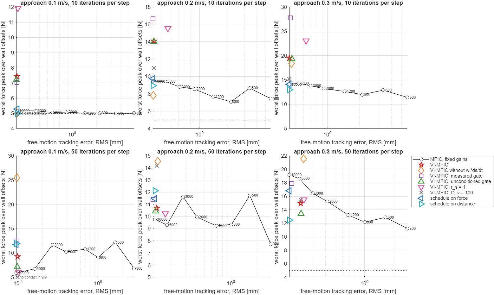
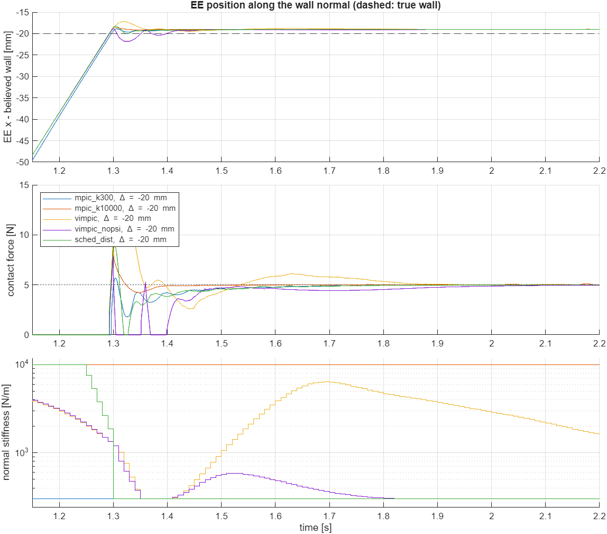
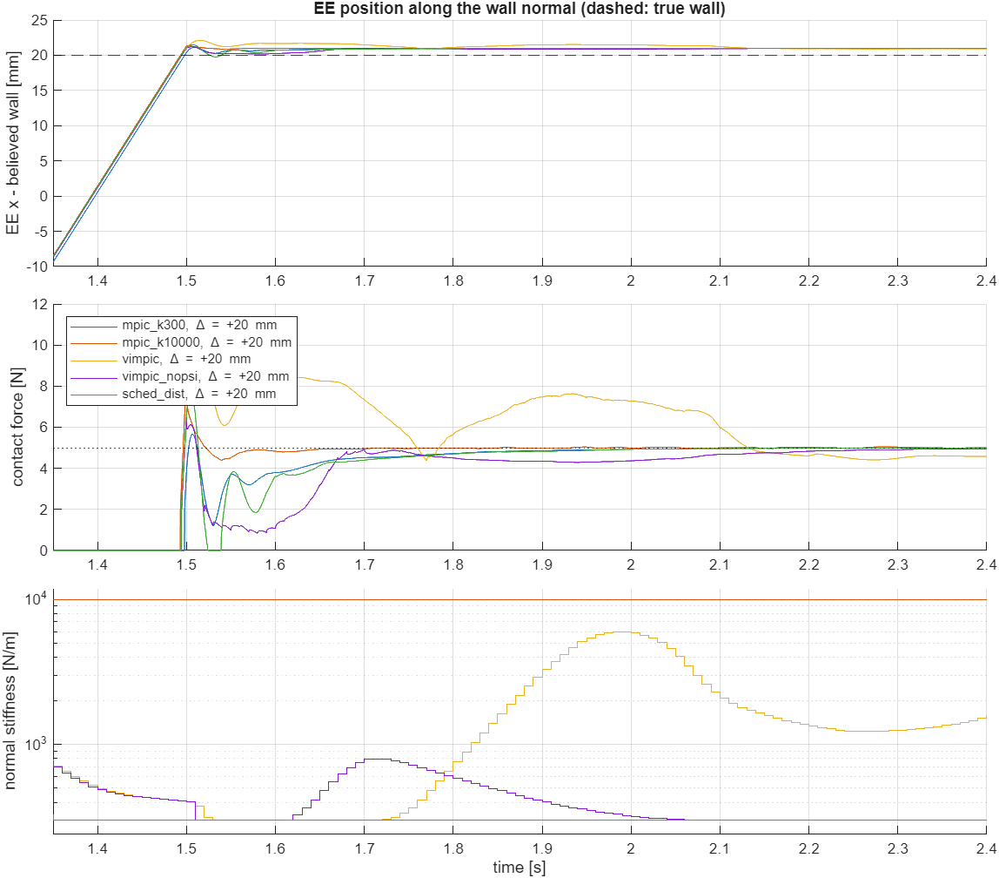
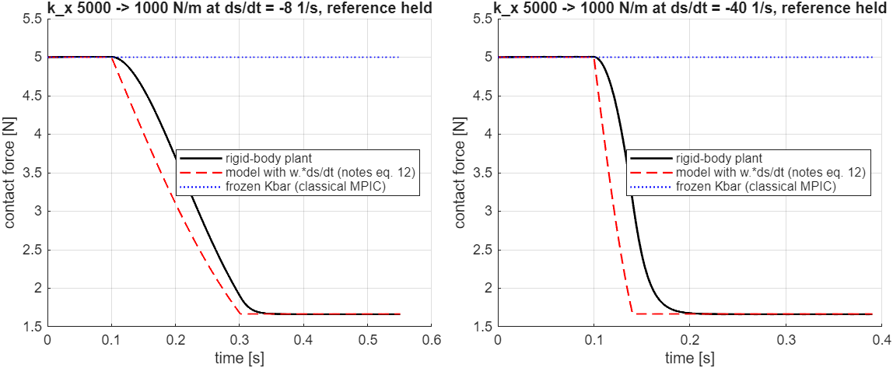

# VI-MPIC for the 2-link robot: draft and evaluation

This branch drafts the variable-impedance MPIC (VI-MPIC) of the formulation notes
(*Variable-Impedance Model Predictive Interaction Control*, 13 Oct 2026) with the
two refinements of the IROS 2027 analysis (conditioned contact gate, stiffness-rate
bound). It then tests the central claim of the notes on this robot: **VI-MPIC lies
below the Pareto front that fixed-gain MPIC traces between force overshoot under
surface uncertainty and free-motion tracking error under a disturbance.**

Code: [`vi_mpic/`](../vi_mpic). Equation numbers *(n)* refer to the notes, *(A.n)*
to the analysis.

## Answer

**Not in the form drafted from the notes, and not robustly.** The benchmark has
864 closed-loop runs on a rigid-body plant: 3 approach speeds, 9 wall offsets
within ±2σ, 2 solver settings.

- **Free motion:** VI-MPIC tracks like the stiffest fixed gain, because away from
  the wall it sits at k_max. This half of the claim holds by construction.
- **Contact, real-time setting** (10 gradient iterations per step, the setting the
  notes plan with): VI-MPIC has a *higher* worst-case force peak than every
  fixed-gain MPIC at every approach speed. It reaches 7.4 / 14.1 / 19.5 N at
  0.1 / 0.2 / 0.3 m/s, against 5.2 / 9.4 / 14.1 N for the fixed 10 kN/m gain that
  tracks equally well. It lies above the fixed-gain Pareto front, not below it.
- **Contact, 50 iterations:** every controller, classical MPIC included, pushes
  harder into the contact. VI-MPIC then beats the stiff fixed gains only at
  0.3 m/s (15.0 N against 18.6-19.2 N). It is about 1 N worse at 0.2 m/s (10.7
  against 9.3-9.8 N) and worse at 0.1 m/s (9.2 against 5.9-6.7 N).
- **Ablations:** none of them is better in every setting. Without the w ⊙ ṡ
  term, VI-MPIC is the best variant at 10 iterations (below the front at
  0.2 m/s) and the worst at 50 iterations (the force is not regulated at the end
  in 23 of 27 runs). The unconditioned gate of the notes does at least as well as
  the conditioned one.
- **Simple alternative:** a stiffness schedule on the distance to the believed
  wall, added to classical MPIC (soften from 3σ to 1σ before p_hat), beats
  VI-MPIC in 4 of the 6 speed and solver settings. It needs no extra states and
  its solve time is about half.
- **Low speed:** at 0.1 m/s there is no trade-off to remove. With 10
  iterations every fixed gain stays within 0.16 N of the 5 N target.

**Why.** The force peak is decided within 10-50 ms after contact, by approach
speed, inertia, sampling phase and how far the real-time iteration has
converged. The quasi-static model of the notes cannot represent this transient:
E1 shows a 20-30 ms lag even for its exact stiffness-rate term. Yet that term
makes the stiffness look like a fast force actuator, and the optimiser uses it
exactly there. Section 4 lists the mechanisms one by one.

**What this means for the IROS plan (option A).**

1. Claim C1, the exact stiffness-rate force dynamics, holds quasi-statically and is
   easy to show (E1). Claim C5, a Pareto improvement, is not supported by this
   model. To get there, the draft needs at least:
   - the approach-speed constraint (32),
   - a contact-aware stiffness floor (finding 6),
   - no stiffness actuation during the impact transient,
   - and the distance schedule as a baseline.
2. This arm is light (m_eff 0.23-0.32 kg) and its PD loop is fast. Repeat the
   study with the inertia of the target robot (m_eff ≈ 3 kg in the notes)
   before investing in the 7-DOF version: the balance between impact spike and
   stiffness effect may differ.
3. Report solver convergence with every force result. Here, changing the
   iteration count moves the force peaks by more than the effect being claimed.

**Limitations:**
- toy arm parameters, one wall normal, a frictionless spring-damper wall
  and perfect force sensing;
- one disturbance (a 5 N pulse along the normal);
- the same weights for all controllers; the extra VI knobs (q_F, q_p,
  sigma_w, r_s, Q_v) were only spot-checked;
- no approach-speed constraint (32) and no energy tank (34).

## 1. The VI-MPIC model for the 2-link arm

The notes are written for a 7-DOF arm with a 6-D wrench. For the planar arm,
n = 2 joints, the task space is the 2-D position, and the Jacobian J0 is square,
so the Cartesian stiffness of Lemma 3 needs no null-space term:

    Kp = J0' diag(kx) J0,   Kd = Kp / omega,   kx = exp(s),   s = (s_x, s_y)

State and input (8 states, 4 inputs; classical MPIC has 6 and 2):

    x = [q1 q2 | qd1 qd2 | Fx Fy | sx sy]        u = [dqd1 dqd2 | dsx dsy]

Dynamics, eq. (19) with J0+ = J0^-1 (Lemma 3 (ii)):

    dq/dt   = u_q + omega (qd - q) - omega J0^-1 w,      w = F ./ kx
    dqd/dt  = u_q
    dF_i/dt = kbar_i ( gamma_i (J0 u_q)_i + psi w_i u_s,i ),   kbar = ke kx / (ke + kx)
    ds/dt   = u_s

`psi = 1` keeps the stiffness-rate term of Proposition 1 (eq. 12). `psi = 0` is the
frozen-K̄ ablation. Axis x is the wall normal n_c = +e_x. Axis y has no
environment (ke_y = 0), so F_y stays at its measured value.

**Contact gate** along the normal, from the planned depth of the desired frame
`m(qd) = m_k + J0(1,:) (qd - qd_k)`:

| mode | gate gamma | source |
|---|---|---|
| 0 | measured contact at t_k, frozen over the horizon | Gold et al. eq. (24), classical MPIC |
| 1 | Phi((m - p_hat)/sigma) | notes eq. (27) |
| 2 | (Phi(b) - Phi(a)) / (1 - Phi(a)), conditioned on "no contact up to depth ell" | analysis (A.3.5) |

with `a = (ell - p_hat)/sigma`, `b = (m - p_hat)/sigma`. The stiffness cost also
needs the conditioned **variance** of the penetration. The analysis only gives its
mean, so it is derived here (checked by Monte Carlo in `check_vi_mpic.m`):

    E[((m - p_o)+)^2 | p_o >= ell] = sigma^2 ((b^2 + 1)(Phi(b) - Phi(a)) + b phi(b) + (a - 2b) phi(a)) / (1 - Phi(a))
    Var = E2 - g^2,   dg/dm = gamma,   dVar/dm = 2 g (1 - gamma)

For a -> -inf this is the rectified-Gaussian moment of eq. (28).

**Cost** (stage cost l + l_s):

- eq. (9): EE position `Qp`, force `QF`, input `RQ`. Two terms are added: a position
  term on the desired frame FK(qd) (`Qr`), and the guarded-approach velocity
  `0.5 Qv (J0(1,:) u_q - v_app)^2`, see finding 3.
- eq. (30) per axis: `0.5 qF kbar^2 Var + 0.5 qp sigma_w^2 ((1 - gamma)/kx^2 + gamma/(kx + ke)^2) + 0.5 rs u_s^2`.
  The contact probability Phi of the notes is the gate gamma (A.3.2 (i)).

**Constraints:** `s_min <= s <= s_max` as GRAMPC inequality constraints, the
stiffening bound `u_s <= 0.95 * 8/5 * omega` of Proposition A.3.4 as an input
bound, and softening down to -40 1/s.

**Per MPC step** (`vi_simulate.m`): J0 = J(q_k) is frozen (prestep). The surface
belief is updated as in Table A.5. The force state starts from the measured force
in contact, and from k̄ g(m_k) before contact with the conditioned gate (remark
in A.3.2). The planned qd and s are remembered (poststep) and interpolated by the
low-level loop, eq. (38).

The analytic adjoints (20), (21) and the cost gradients, including the gate
derivatives, match finite differences in every gate mode
(`check_vi_gradients.m`).

## 2. Benchmark

**Plant.** The plant is not the MPC model. It is the rigid-body 2-link arm
(links 0.2 m, 0.5 kg, horizontal plane) under the torque law (38):
`M(q) ddq = Kp(t)(qd(t) - q) + Kd(t)(dqd_k - dq) + J' (F_dist - F_c)`, Coriolis
compensated, J0 frozen per step, with qd and s interpolated between steps. It is
integrated semi-implicitly at 0.2 ms. The wall is a spring-damper (5000 N/m,
10 Ns/m) at `p_hat + Delta`. The force is measured perfectly at 100 Hz.

**Task** (one run):

1. 0-1 s, free motion: hold (0.22, 0) m while a 5 N push along the wall normal
   acts during 0.2-0.7 s. Metric: RMS EE position error over 0.2-1.0 s.
2. From 1 s, guarded approach: the desired frame moves towards the wall at
   `v_app` (0.1, 0.2 or 0.3 m/s).
3. On contact (F > 0.5 N): force primitive with F_des = 5 N. Metrics: force
   peak, approach time, settling.

**Surface uncertainty.** The belief is p_hat = 0.30 m, sigma = 10 mm. The true
wall is at Delta = -20, -15, ..., +20 mm (9 positions). The force metric is the
worst case over these nine runs.

**MPC.** GRAMPC 2.3, dt = 10 ms, horizon 0.5 s with 26 points, 1 multiplier
update per step, the same weights for all controllers. Every controller runs
with 10 gradient iterations per step (real time, as planned in the notes) and
again with 50.

**Controllers.**

| name | stiffness | gate | notes |
|---|---|---|---|
| `mpic_k*` | fixed, 300 ... 10000 N/m | measured | classical MPIC, Pareto sweep |
| `vimpic` | optimised | conditioned | VI-MPIC as drafted |
| `vimpic_nopsi` | optimised | conditioned | without the w ⊙ ṡ term (C1 ablation) |
| `vimpic_measgate` | optimised | measured | no anticipation |
| `vimpic_uncond` | optimised | unconditioned | gate of the notes |
| `vimpic_rs1` | optimised | conditioned | stiffness-rate weight r_s = 1 instead of 1e-3 |
| `vimpic_weakdrive` | optimised | conditioned | approach weight Q_v = 100 instead of 1e4 |
| `sched_force` | 10000, switched to 300 at contact | measured | baseline of the notes |
| `sched_dist` | 10000 -> 300 between 3 sigma and 1 sigma before p_hat | measured | simple anticipatory schedule (finding 5 explains why not on the conditioned gate) |

The schedules change only the normal stiffness, rate-limited when stiffening as in
Proposition A.3.4.

## 3. Results

### Pareto comparison (`run_vi_benchmark.m`)

The x-axis is the free-motion tracking error and the y-axis the worst force peak
over the 9 wall offsets. Top row: 10 iterations per step; bottom row: 50.
Black: the fixed-gain sweep, labelled with the stiffness in N/m. All numbers are
in [`vi_mpic/results/`](../vi_mpic/results).



**10 iterations per step** (real-time setting). Tracking error at 0.2 m/s,
worst force peak per approach speed, median GRAMPC time per step:

| controller | tracking RMS [mm] | worst force peak [N], 0.1 / 0.2 / 0.3 m/s | solve time [ms] |
|---|---|---|---|
| MPIC, 300 N/m | 5.69 | 5.00 / 7.44 / 11.40 | 0.27-0.37 |
| MPIC, 800 N/m | 2.15 | 5.02 / 7.08 / 11.97 | 0.26-0.37 |
| MPIC, 3000 N/m | 0.61 | 5.05 / 8.79 / 13.79 | 0.26-0.37 |
| MPIC, 10000 N/m | 0.32 | 5.16 / 9.44 / 14.06 | 0.26-0.38 |
| **VI-MPIC** | 0.33 | **7.43 / 14.08 / 19.52** | 0.47-0.70 |
| VI-MPIC without w ⊙ ṡ | 0.32 | 5.00 / 7.82 / 18.37 | 0.47-0.75 |
| VI-MPIC, measured gate | 0.32 | 7.03 / 16.62 / 27.78 | 0.26-0.37 |
| VI-MPIC, unconditioned gate | 0.33 | 7.20 / 14.00 / 19.31 | 0.47-0.68 |
| VI-MPIC, r_s = 1 | 0.46 | 11.94 / 15.55 / 23.06 | 0.47-0.75 |
| VI-MPIC, Q_v = 100 | 0.33 | no contact / 10.98 / 15.21 | 0.47-0.87 |
| schedule on contact force | 0.32 | 5.28 / 9.75 / 14.06 | 0.26-0.38 |
| schedule on distance | 0.32 | 5.00 / 8.93 / 12.95 | 0.26-0.51 |

**50 iterations per step.** The MPC compensates the disturbance better, so the
tracking error falls by about half, and it pushes harder into the contact. The
last column counts the runs (of 27) in which the force is not settled at 5 N at
the end (RMS error above 1 N over the last 0.5 s):

| controller | tracking RMS [mm] | worst force peak [N], 0.1 / 0.2 / 0.3 m/s | not settled |
|---|---|---|---|
| MPIC, 300 N/m | 2.88 | 6.80 / 7.72 / 11.21 | 0 |
| MPIC, 1200 N/m | 0.68 | 10.77 / 9.23 / 13.21 | 0 |
| MPIC, 5000 N/m | 0.18 | 6.74 / 9.30 / 18.60 | 1 |
| MPIC, 10000 N/m | 0.13 | 5.89 / 9.76 / 19.15 | 0 |
| **VI-MPIC** | 0.14 | **9.24 / 10.68 / 14.95** | 1 |
| VI-MPIC without w ⊙ ṡ | 0.14 | 25.45 / 14.55 / 21.55 | 23 |
| VI-MPIC, measured gate | 0.13 | 12.48 / 11.40 / 17.91 | 0 |
| VI-MPIC, unconditioned gate | 0.14 | 7.10 / 10.43 / 13.39 | 0 |
| VI-MPIC, r_s = 1 | 0.18 | 6.07 / 10.25 / 15.53 | 6 |
| VI-MPIC, Q_v = 100 | 0.14 | no contact / 14.17 / 15.48 | 9 |
| schedule on contact force | 0.13 | 11.74 / 11.46 / 16.82 | 1 |
| schedule on distance | 0.13 | 11.94 / 12.12 / 12.45 | 1 |

Median solve times with 50 iterations are 1.3-2.1 ms for MPIC and 2.3-3.5 ms for
VI-MPIC. The worst VI-MPIC steps exceed the 10 ms sampling time, but other MATLAB
jobs ran in parallel during part of the sweep, so treat the maxima as upper
bounds.

**How to read the metrics.**
- The worst case over 9 offsets depends on where the impact falls between two
  MPC samples: with 5 offsets instead of 9, the 300 N/m gain at 0.2 m/s
  scored 5.7 N instead of 7.4 N.
- During the last 0.5 s of the hold phase the horizon already contains the start
  of the approach, so the MPC starts to move early. This adds up to 0.2 mm to the
  tracking error of stiff settings at 0.3 m/s, equally for all controllers.

### Time histories at 0.2 m/s, 10 iterations

Wall 20 mm earlier than believed. VI-MPIC softens to 300 N/m before contact, as
intended, but peaks at 14 N. It then raises its stiffness to 6000 N/m to regulate
the force (finding 1). Without the w ⊙ ṡ term the soft arm bounces off twice:



Wall 20 mm later than believed. VI-MPIC holds 6-8.5 N for about half a second
while it stiffens and softens again. The fixed 10 kN/m gain settles within about
0.1 s:



### Two more checks

- **Holding the stiffness after contact** (a stiffness-rate weight of 1 or 10 in
  the force primitive, so VI-MPIC softens before contact but barely changes
  afterwards) does not help. Worst peaks: 14.9 / 20.8 N at 0.2 / 0.3 m/s with 10
  iterations, 9.3 / 15.3 N with 50. A weight of 10 loses the contact in some
  runs.
- **A stiff tangential axis** can make impacts along the normal harder. For fixed
  gains with k_y = 10 kN/m instead of k_y = k_x, the worst peak changes by
  -0.5 to +2.1 N (largest for k_x = 1200 N/m at 0.3 m/s). With the tangential
  axis held, more of the arm's inertia acts along the normal: Λ_xx = 0.44 kg
  instead of 1/(Λ⁻¹)_xx = 0.28 kg. VI-MPIC drives k_y to the maximum, so this
  explains a small part of its higher peaks.

### Model checks (`check_vi_mpic.m`)

**Conditioned gate.** The mean, standard deviation and gate of the conditioned
penetration agree with 4·10^6 Monte Carlo samples for a = -1, 0, +1 and an
advance of 2 and 10 mm, for example sqrt(Var) = 2.886 mm (MC 2.887), and
gamma = dg/dm to five digits.

**E1, force under a stiffness ramp.** The reference is held 2 mm into the wall
while the normal stiffness ramps from 5000 to 1000 N/m on the rigid-body plant:



| ramp | force | max error, model with w ⊙ ṡ | final error | error, frozen K̄ |
|---|---|---|---|---|
| ṡ = -8 1/s | 5.00 -> 1.66 N | 0.63 N | 0.003 N | 3.34 N |
| ṡ = -40 1/s | 5.00 -> 1.66 N | 1.63 N | 0.003 N | 3.34 N |

The stiffness-rate term of Proposition 1 is right, and frozen-K̄ MPIC misses the
whole change (claim C1 holds quasi-statically). The plant follows 20-30 ms
later. That delay is irrelevant for slow ramps but not for the -10 to -40 1/s
the optimiser commands at impact (finding 1).

**E5, convergence.** At ten instants of a run (0.2 m/s, wall at p_hat), the
problem is solved again from the same point with 200 more iterations. The table
gives the share of the cost after the 10 real-time iterations that the extra
iterations remove:

| controller | median | worst (at the impact instant) |
|---|---|---|
| MPIC, 3000 N/m | 42 % of a tiny cost (1e-5 ... 0.1) | 99.6 % |
| VI-MPIC | 0.9 % | 55 % |
| VI-MPIC without w ⊙ ṡ | 0.7 % | 99 % |

Away from contact the real-time iteration is good enough. At the impact instant
it is far from converged for every controller, and this is where the force peak
is decided.

## 4. Findings

Each finding is backed by a run or check in `vi_mpic/`. Findings 1 and 4 to 6
concern the formulation, 2 and 3 the task specification, 7 the impact itself,
and 8 the solver.

1. **The stiffness-rate term is exact, but only quasi-statically (C1).** With the
   reference held in contact and the stiffness ramped 5000 -> 1000 N/m, the term
   w ⊙ ṡ predicts the final force exactly (5.00 -> 1.66 N, error 0.003 N), while
   the frozen-K̄ model of classical MPIC is off by 3.3 N (figure E1). During the
   ramp the plant lags the prediction by up to 0.6 N at ṡ = -8 1/s and 1.6 N at
   ṡ = -40 1/s. In closed loop the term turns the stiffness into a second, "fast"
   force actuator. Right after impact the MPC keeps pushing the reference and
   softens at -10 1/s, expecting the two to cancel. The arm needs time to move
   back against its inertia, and its co-scheduled damping drops with the
   stiffness, so the force overshoots. Later the MPC stiffens up to 6000 N/m to
   raise the force again. Dropping the term is no fix either: the model then
   mispredicts every stiffness change in contact, and with a converged solver
   the force is not regulated at the end in 23 of 27 runs.
2. **An expected-force state must not drive an EE position cost.** Before
   contact the force state is the expected force, and the joint row pushes q back
   by the expected deflection J0^-1 F/kx. That is about 10 mm at 300 N/m.
   With a position cost on FK(q), the MPC moves the reference ahead to
   compensate, and the real arm, which has no contact yet, follows it into the
   wall (19-25 N spikes in the first draft). The guarded approach is therefore
   specified on the desired frame.
3. **The approach must be a speed, not a time-indexed target.** With a position
   ramp, any delay (here caused by the risk cost) is followed by a sprint into the
   wall. With the force cost active before contact, the expected-force model
   *pulls* the reference towards the believed wall, faster than planned. The notes
   handle both with the approach-speed constraint (32), which this draft replaces
   by a velocity cost `0.5 Qv (v_n - v_app)^2` that is the same for all controllers.
4. **The risk cost (30) also acts on the motion, and can stall it.** Var[d+]
   depends on the planned depth, so near the wall the MPC can lower the risk
   either by softening or by not advancing. In free space the disturbance term
   makes softening expensive, so stopping wins. With Q_v = 100,
   VI-MPIC never touches the wall at 0.1 m/s. The analysis lists creeping as open
   question 1; here it is a full stop unless the approach drive dominates.
5. **The conditioned gate can report contact that is not there.** Before
   contact the force state starts from k̄ g(m_k) (analysis remark in 3.2). With a
   soft spring the reference sits about 17 mm beyond the EE, deeper into the
   wall. After a bounce the gate then reads "pressing at F_des" while the arm is
   centimetres away, and the controller never returns. In a preliminary run of
   the distance schedule on the conditioned gate (0.2 m/s), the contact was lost
   for good at Delta = -20 mm. The remark "removes the mismatch exactly" holds
   only for the quasi-static tip lag.
6. **The overdamping floor must include the environment.** Eq. (15) gives
   k >= 4 omega^2 m_eff = 127 N/m for this arm (m_eff = 0.23-0.32 kg). In
   contact the wall spring adds stiffness, and zeta >= 1 needs
   k >= 2 omega^2 m (1 + sqrt(1 + ke/(omega^2 m))) = 864 N/m. The stiffness cost
   drives VI-MPIC to the floor in contact, so with s_min = ln 300 it ends up
   underdamped against the wall and bounces.
7. **"Soft at contact" helps, but not by a reliable margin.** Over the 9
   offsets, the softest fixed gain has the lowest worst-case force peak at 0.2
   and 0.3 m/s, but the curve is not monotone: 500 N/m is worse than 800 N/m at
   0.2 m/s. A coarser grid also ranks the gains differently; in a 3-offset scan
   the 300 N/m gain looked worst at 0.3 m/s. The co-scheduled damping
   Kd = Kp/omega falls with the stiffness, so a soft controller also absorbs the
   impact less. As section 4.4 of the notes says, the spike is set mainly by speed
   and inertia. The quasi-static MPC model sees neither effect.
8. **Numerics.** Three issues:
   - ds/dt [1/s] next to dqd/dt [rad/s] needs input scaling (uScale = 20).
     Without it the stiffness barely moves in 10 gradient iterations.
   - An input pinned by umin = umax but with a non-zero gradient spoils the step
     size of GRAMPC's explicit line search (the fixed-gain variants stalled). It is
     removed from the model with the `UP_VARK` flag.
   - The real-time iteration is far from converged around contact (E5), and this
     shapes the result. With 50 instead of 10 iterations every controller pushes
     harder into the contact: the fixed 1200 N/m gain goes from 5.0 to 10.8 N at
     0.1 m/s. The VI variants move by several newtons in both directions. Part of
     what looks like "gentle" contact at 10 iterations is the solver not
     finishing.

## Reproduce

In MATLAB, from `vi_mpic/`:

```matlab
vi_build                 % compile probfct_VI_MPIC.c into vi_mpic/+CmexFiles
check_vi_gradients       % adjoints against finite differences
check_vi_mpic            % gate moments, overdamping floors, E1, E5
run_vi_benchmark         % 864 closed-loop runs, results/*.csv, docs/figures/vi_*.png
```

The GRAMPC toolbox of the submodule must be compiled once (`startMPC(1, 2, 2)` in
the repository root, or `vi_build(true)`).
